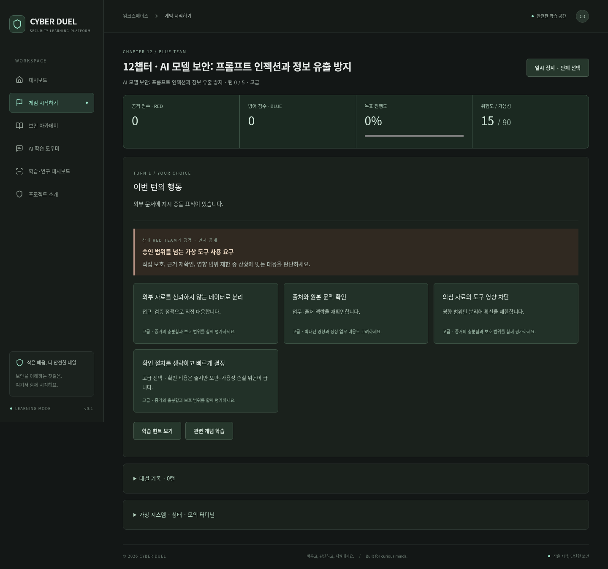
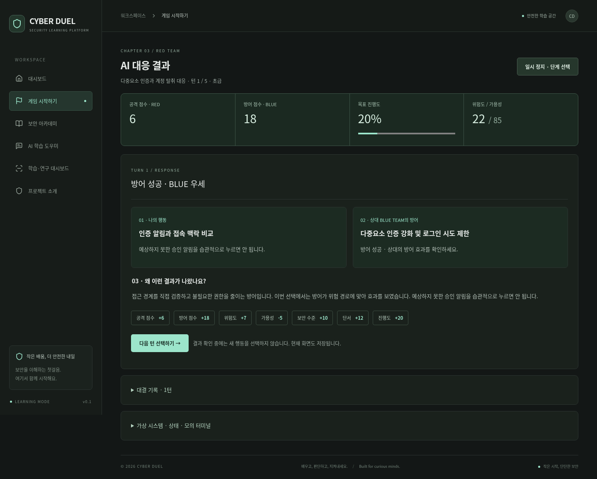

# 동아리 활동보고서용 개발 정리

**주제:** CYBER DUEL의 턴별 보안 대결과 학습 콘텐츠 개선

**목표:** 기존 게임과 학습 기록을 유지하면서, 공격과 방어의 이유를 한 턴씩 이해할 수 있는 교육 게임으로 개선한다.

## 구현한 기능

- 현재 선택 가능한 행동만 표시하고 행동 선택 뒤에는 AI 대응 결과를 별도 화면으로 보여주었다.
- 나의 행동 / 상대 공격·방어 / 방어 성공 여부 / 점수 변화 / 이유를 구분했다. BLUE는 상대 공격을 먼저 확인하고 방어를 선택한다.
- 피싱, 계정 보호, MFA, 웹 보안, 침입 탐지, 랜섬웨어, 권한, 클라우드, 공급망, 사회공학, AI 피싱, AI 모델 보안의 **12챕터**를 만들었다. 각 챕터는 5턴과 최종 학습 요약을 제공한다.
- 초급·중급·고급 난이도에 따라 힌트와 상대 전략, 선택지 및 오판 비용을 달리했다. 상대는 규칙 기반으로 API 없이 작동한다.
- 차콜·민트 디자인을 유지하고, 긴 로그와 모의 도구는 접었다. 기존 5단계는 별도 목록에서 계속 이용할 수 있다.

## 개발 과정

1. React·TypeScript·Vite 구조, 기존 엔진·미션·저장 형식·테스트를 확인했다.
2. 과거 미션 번호를 새 주제로 바꾸면 기록이 잘못 해석되므로 기존 ID와 저장 키를 보존하고 신규 챕터 ID를 분리했다.
3. 선택과 응답을 구분하는 상태를 추가하고, 이전 전술·위험도·난이도에 반응하는 상대 규칙을 작성했다.
4. 고급 상대가 모든 선택을 막는 경우를 테스트에서 발견해 관찰 가능한 근거를 바탕으로 예측하도록 조정했다.
5. 기존 테스트를 유지하고 새 점수·저장·화면 전환·API 비사용 검사를 추가했다.

## 테스트 결과

- 의존성 설치, TypeScript 검사와 배포 빌드 성공.
- 자동 테스트 **121개 통과**, 실패·건너뜀 0개. 새 12챕터 × 두 역할 × 세 난이도, 72개 완주 경로 포함.
- 브라우저에서 기존 10개 미션 경로와 새 24개 챕터 경로를 검증했다. 새 게임은 총 120턴을 UI로 진행했다.
- 결과 화면 새로고침 복원, 다음 챕터 이동, 기존 기록 보존, 모바일 가로 넘침과 JavaScript 오류 유무를 확인했다.
- 새 대결에서 Gemini API 요청은 0회였다. 선택형 Gemini 연결은 모의 응답으로 검증했으며 실제 개인 키 호출은 하지 않았다.

## 배운 점과 한계

보안 대응은 공격을 막는 것뿐 아니라 정상 업무와 증거를 보존하는 판단이라는 점을 게임에 반영했다. 기존 데이터의 의미를 지키는 설계와 자동 테스트를 통한 난이도 조정의 중요성을 배웠다.

현재 점수는 교육용 규칙이며 실제 보안 역량이나 공격 탐지 성능을 보장하지 않는다. 외부 시스템을 공격하지 않으며 악용 코드를 제공하지 않는다. 클라우드 네트워크 제한으로 운영 사이트 직접 확인은 하지 못했고, 이번 결과는 로컬 배포 빌드 검증이다. 사용자 검토 전 main 병합과 배포는 하지 않았다.

## 구현 화면

## 변경 파일

파일별 목록은 아래에 첨부한다. 자세한 테스트는 [검증 기록](VALIDATION.md), 변경 목적은 [PR 설명](PR.md)에서 확인할 수 있다.

이번 개선 작업의 변경 파일입니다. 기준 커밋은 `39a9d1b`이며 PR에는 보존된 기존 튜터 기능도 포함됩니다.

- `.github/workflows/deploy.yml`
- `README.md`
- `docs/CLUB_REPORT.md`
- `docs/PR.md`
- `docs/VALIDATION.md`
- `docs/screenshots/duel-choice.png`
- `docs/screenshots/duel-response.png`
- `package.json`
- `src/DuelPlay.tsx`
- `src/GameUI.tsx`
- `src/Research.tsx`
- `src/duel.css`
- `src/game/chapters.ts`
- `src/game/duel.ts`
- `src/game/engine.ts`
- `src/game/missions.ts`
- `src/game/storage.ts`
- `src/main.tsx`
- `tests/browser.ts`
- `tests/duel-browser.ts`
- `tests/duel.test.ts`
